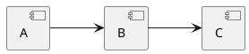

# Подробный разбор практической работы 2, вариант 22

Документ объясняет упрощенное решение и порядок его разработки.
Рядом удобно открыть `src/main.py`, `src/repository.py`, `src/graph.py`
и `src/plantuml.py`. Все команды ниже выполняются из папки нужного этапа.

## 1. Что делает работа

Задача — получить зависимости пакета Alpine Linux и представить их графом.
Пользователь задает имя пакета, точную версию и источник метаданных.
Вместо настоящего репозитория можно использовать учебный JSON.

Работа состоит из пяти последовательных этапов:

| Этап | Результат |
| --- | --- |
| 1 | Четыре параметра CLI и их вывод в формате ключ=значение |
| 2 | Чтение APKINDEX и вывод прямых зависимостей заданной версии |
| 3 | Рекурсивный DFS, транзитивные связи, циклы и тестовый JSON |
| 4 | Обратные зависимости с тем же DFS |
| 5 | Описание графа на языке PlantUML и сравнение трех пакетов с APK |

Временный вывод этапа находится только в соответствующем коммите.
Поэтому для показа обратных зависимостей используется папка этапа 4,
а итоговая папка этапа 5 печатает PlantUML.

У каждого этапа есть собственные файлы и README.
Папки `stage1`–`stage5` являются полными снимками, а не наборами отдельных изменений.
В основном проекте последняя версия находится в `practice2`.

## 2. Связь с первой практической

В первой работе была оболочка с виртуальной файловой системой.
Здесь нет REPL и команд `ls`, `cd`, `rm`, поэтому класс Shell не используется.
Сохранены знакомые приемы из первой работы:

- Python и стандартная библиотека.
- `argparse` для параметров запуска.
- `Path.read_text` и `json.loads` для чтения JSON.
- Обычные словари для хранения данных в памяти.
- `run.sh`, который сначала переходит в папку проекта.
- `unittest` для тестов.
- Вывод ошибок в точке входа приложения.

Функция `conf_dump` первого этапа повторяет прием из первой практической:
перебирает настройки и выводит каждую как `ключ=значение`.
После первого этапа эта функция удаляется, поскольку вывод настроек нужен только там.

Функции работы с виртуальными каталогами сюда переносить не требуется.
Вместо VFS появляется Repository, который хранит сведения о пакетах.
Общий принцип такой же: один раз загрузить данные, затем работать с ними в памяти.

## 3. Зависимость как направленная связь

Пусть A использует B, а B использует C:

```text
A -> B -> C
```

Для A пакет B — прямая зависимость.
Пакет C — транзитивная зависимость: он нужен через B.
В графе пакеты называются вершинами, а стрелки — ребрами.
Стрелка всегда читается как «слева зависит от справа».

Обратный вопрос: кто зависит от C?
Ответом будут B и A. Это обратные зависимости C.
Сам C в список своих потребителей не выводится.

У графа может быть общая зависимость:

```text
A -> B -> D
A -> C -> D
```

Вершина D одна, но к ней ведут две разные связи.
Поэтому результат представляет собой граф, а не только дерево обхода.

Возможен цикл:

```text
A -> B -> C -> A
```

Все три связи нужно сохранить, но повторный обход A нужно остановить.
Именно это делает проверка посещения в DFS.

## 4. Файлы решения

| Файл | Ответственность |
| --- | --- |
| `src/main.py` | Чтение четырех параметров и запуск текущего этапа |
| `src/repository.py` | Чтение APKINDEX или JSON, поиск пакетов и библиотек |
| `src/graph.py` | Рекурсивный DFS и получение графа |
| `src/plantuml.py` | Преобразование графа в описание PlantUML |
| `fixtures/` | Три учебных графа и метаданные настоящих примеров |
| `examples/` | Три PlantUML и три настоящих вывода apk dot |
| `tests/` | Тесты требований соответствующего этапа |

В этапе 4 в `graph.py` есть функция `reverse_graph`.
В этапе 5 она удалена: режим обратных зависимостей нужен только четвертому этапу.
Обычный DFS и прямой граф сохраняются для визуализации.

## 5. Запуск и четыре настройки

Пример для итогового этапа:

```sh
sh run.sh --test-repo --repo fixtures/diamond.json \
  --package A --version 1.0
```

Результат — текст PlantUML в терминале.
Можно запускать и без shell-скрипта:

```sh
python3 -m src.main --test-repo --repo fixtures/diamond.json \
  --package A --version 1.0
```

`-m src.main` запускает main.py как модуль пакета src.
Это необходимо для относительных импортов `from .graph import ...`.
Пустой файл `src/__init__.py` обозначает пакет Python.

| Параметр | Что задает |
| --- | --- |
| `--package` | Имя исходного пакета |
| `--version` | Его точную версию |
| `--repo` | URL каталога репозитория или путь к JSON |
| `--test-repo` | Чтение учебного JSON вместо APKINDEX |

Три строковых параметра обязательны.
У переключателя `--test-repo` нет отдельного значения: присутствие означает True,
отсутствие — False. Запись `--test-repo=yes` является ошибкой argparse.

Относительные пути у `run.sh` считаются от папки самого скрипта.
При вызове из корня общего проекта команда начинается с `sh practice2/run.sh`,
но путь к данным остается `fixtures/diamond.json`.

## 6. Этап 1: чтение параметров

Функция `read_args` создает ArgumentParser и описывает четыре параметра.
Например:

```python
parser.add_argument("--package", required=True, help="имя пакета")
```

`required=True` означает обязательный параметр.
`help` задает описание для встроенной справки `--help`.
`argparse` самостоятельно обрабатывает отсутствующий параметр,
неизвестный ключ и неправильное использование переключателя.

После `parse_args` программа проверяет ошибки пользовательского ввода,
которые требуются в первом этапе.

Для имени используется `re.fullmatch`.
В настоящем режиме допустимы имена APK вроде `zlib`, `xz-libs`.
В тестовом режиме имя задается большими латинскими буквами, например A.
Проверка версии простая: строка не должна быть пустой.
Наличие самой версии проверяется после загрузки репозитория.

Если включен тестовый режим, путь должен указывать на существующий файл.
Иначе URL разбирается через `urlparse` и проверяется наличие HTTP(S)-адреса.
Ошибка самого разбора URL тоже передается в `parser.error`.

`parser.error` выводит сообщение со справкой и завершает процесс с кодом 2.
Отдельной системы проверки настроек или собственных классов ошибок нет.

### Вывод конфигурации

В папке первого этапа выполняется, например:

```sh
sh run.sh --package zlib --version 1.3.2-r1 \
  --repo https://dl-cdn.alpinelinux.org/alpine/v3.22/main/x86_64
```

```text
package=zlib
version=1.3.2-r1
repo=https://dl-cdn.alpinelinux.org/alpine/v3.22/main/x86_64
test_repo=False
```

Функция `conf_dump` получает словарь атрибутов через `vars(args)`.
Метод `items()` дает пары ключ-значение, которые выводятся обычным циклом.
На этом первый этап заканчивается: ни сеть, ни JSON пока не читаются.

## 7. Этап 2: получение метаданных APK

В репозитории Alpine для определенной ветки и архитектуры есть файл
`APKINDEX.tar.gz`. Внутри находится текстовый файл APKINDEX.
Для получения зависимостей достаточно прочитать индекс;
сам пакет устанавливать и запускать не требуется.

Источник задается до каталога архитектуры:

```text
https://dl-cdn.alpinelinux.org/alpine/v3.22/main/x86_64
```

Функция `load_apk` убирает завершающий `/` и добавляет `/APKINDEX.tar.gz`.
Пользователю не нужно указывать имя архива отдельно.

Затем выполняется HTTP-запрос:

```python
with urlopen(url, timeout=NETWORK_TIMEOUT) as response:
    data = response.read()
```

`urlopen` относится к стандартной библиотеке urllib.request.
`read()` возвращает байты ответа.
`with` закрывает ресурс после выхода из блока.
Константа NETWORK_TIMEOUT ограничивает ожидание ответа.

Байты передаются в `io.BytesIO`.
Так tarfile может читать их как файл, хотя они находятся в памяти:

```python
with tarfile.open(fileobj=io.BytesIO(data), mode="r:gz") as archive:
    text = archive.extractfile("APKINDEX").read().decode("utf-8")
```

`r:gz` означает чтение gzip-сжатого tar-архива.
`extractfile` читает один нужный файл внутри архива.
Каталоги и файлы архива на диск не распаковываются.
Декодирование превращает байты APKINDEX в строку Python.

Менеджеры пакетов и сторонние библиотеки для получения этих данных не используются.

## 8. Разбор полей APKINDEX

Запись пакета в сокращенном виде:

```text
P:zlib
V:1.3.2-r1
D:so:libc.musl-x86_64.so.1
p:so:libz.so.1=1.3.2
```

От следующего пакета запись отделена пустой строкой.
Используются только четыре поля:

| Поле | Смысл |
| --- | --- |
| `P` | Имя пакета |
| `V` | Версия |
| `D` | Объявленные зависимости |
| `p` | Предоставляемые имена библиотек или команд |

Заглавная P и строчная p — разные поля.
Функция `parse_index` делит текст по пустым строкам, затем перебирает строки записи.

```python
key, _, value = line.partition(":")
fields[key] = value
```

`partition` отделяет только первое двоеточие.
Поэтому значение `so:libc...` сохраняется целиком.
`_` принимает разделитель, который дальше не используется.

`fields.get("D", "").split()` превращает строку зависимостей в список.
Если поле D отсутствует, получается пустой список.
Так же обрабатываются предоставляемые имена из поля p.

Одна запись становится обычным словарем:

```python
{
    "name": "zlib",
    "version": "1.3.2-r1",
    "depends": ["so:libc.musl-x86_64.so.1"],
    "provides": ["so:libz.so.1=1.3.2"],
}
```

Результат `parse_index` — список таких словарей.
Дополнительного анализатора структуры индекса нет: читаются необходимые поля формата APK.

## 9. Хранение и выбор версии

Repository получает список записей и помещает их в `self.packages`.
Ключом является кортеж `(имя, версия)`:

```python
key = (package["name"], package["version"])
self.packages[key] = package
```

Это позволяет хранить несколько версий одного имени без перезаписывания.
Например, A версии 1.0 и A версии 2.0 остаются двумя отдельными записями.

Метод `get` перебирает записи:

```python
if package_name == name and (
    not version or package_version == version
):
    return package
```

Если версия передана, должны совпасть и имя, и версия.
Поэтому `get("A", "2.0")` не может вернуть A версии 1.0.
Если версия не передана, возвращается первая запись с нужным именем.
Последний случай используется при раскрытии зависимостей.

Если совпадения нет, `get` вызывает ValueError с именем и версией пакета.
Это также обеспечивает обработку ошибочно заданной пользователем версии.
В первом этапе неизвестная версия еще не проверяется: репозиторий там не загружается.

## 10. Библиотеки и поставщики

В APK зависимость может быть указана не именем пакета, а именем библиотеки.
Например, `so:libc.musl-x86_64.so.1` предоставляет пакет musl.
Чтобы получить настоящее имя пакета, читается поле p всех записей.

Для него создается словарь providers:

```python
{
    "so:libc.musl-x86_64.so.1": "musl",
    "so:libz.so.1": "zlib",
    "so:liblzma.so.5": "xz-libs",
}
```

`dependency_name` отделяет имя от ограничения версии:

| Запись | Имя |
| --- | --- |
| `musl>=1.2.5` | `musl` |
| `so:libz.so.1=1.3.2` | `so:libz.so.1` |
| `cmd:tool=1.0` | `cmd:tool` |

Для разделения используется короткое регулярное выражение по `<`, `>`, `=` и `~`.
Двоеточие остается частью имени.
Это отделение имени, а не реализация решателя совместимости версий.

При заполнении providers применяется `setdefault`:
если имя уже есть, первый поставщик сохраняется; если его нет — добавляется.
Проверка неоднозначности поставщиков не выполняется.

Метод `resolve` сначала проверяет наличие настоящего имени пакета.
Если такого имени нет, возвращает имя поставщика из словаря providers.
Например:

```text
so:libc.musl-x86_64.so.1 -> providers -> musl
```

Метод `dependencies` вызывает `resolve` для каждой зависимости записи.
В список результатов повторно не добавляется одно и то же имя пакета.
Строки `!имя` обозначают конфликт и не становятся ребрами зависимости.

На втором этапе выводится исходный список depends.
С третьего этапа граф строится по именам реальных пакетов после разрешения библиотек.

## 11. Учебный JSON

Формат тестового репозитория:

```json
{
  "A": {"1.0": ["B", "C"], "2.0": ["C"]},
  "B": {"1.0": ["D"]},
  "C": {"1.0": ["D"]},
  "D": {"1.0": []}
}
```

Внешний ключ — имя пакета большими латинскими буквами.
Вложенный ключ — версия в виде строки.
Значение — список имен непосредственных зависимостей.
Пустой список означает отсутствие зависимостей.

`load_test` использует `json.loads(Path(path).read_text(...))`.
Затем два обычных цикла перебирают пакеты и их версии.
Для каждой пары создается запись того же вида, что и после разбора APKINDEX:

```python
{"name": "B", "version": "1.0", "depends": ["D"], "provides": []}
```

Все записи передаются в Repository.
Поэтому код построения графа одинаков для настоящих и учебных данных.
Отдельных проверок схемы JSON и типов его полей нет.
Учебный файл задается в показанном формате.

В chain.json находится цепочка.
В diamond.json — общий узел D и две версии A.
В cycle.json — цикл, петля и изолированный пакет.
Этих трех файлов достаточно для демонстрации различных случаев из задания.

## 12. Этап 3: рекурсивный DFS

Граф представлен словарем списков соседей:

```python
{"A": ["B", "C"], "B": ["D"], "D": [], "C": ["D"]}
```

Ключ — имя вершины, значение — ее непосредственные зависимости.
Пустой список у D сохраняется, чтобы вершина без зависимостей не потерялась.

Общая функция обхода называется `dfs`.
Внутри нее создается словарь результата и вложенная функция `visit`:

```python
def visit(name):
    if name in graph:
        return
    graph[name] = get_neighbors(name)
    for dependency in graph[name]:
        visit(dependency)
```

Здесь последнее действие вызывает ту же функцию для зависимого пакета.
Это рекурсия, которая прямо требуется вариантом 22.

`graph` одновременно хранит результат и отмечает посещенные вершины.
Отдельное множество visited не нужно.
Если имя уже присутствует среди ключей, повторный вызов сразу заканчивается.

Вершина добавляется до перехода к соседям.
Именно этот порядок позволяет правильно остановить цикл.
Если добавлять вершину только после рекурсивных вызовов, цикл не закончится.

### Порядок обхода ромба

| Шаг | Действие | Посещенные вершины |
| --- | --- | --- |
| 1 | Записать A и ее соседей B, C | A |
| 2 | Перейти к B | A, B |
| 3 | Перейти от B к D, затем вернуться | A, B, D |
| 4 | Вернуться к A и перейти к C | A, B, D, C |
| 5 | D уже посещена, повторно не обходить | A, B, D, C |

Порядок A, B, D, C показывает обход в глубину.
Сначала полностью исследуется ветка B, затем ветка C.

При этом ребро C -> D остается в списке C.
Повторный обход D запрещен, но сама связь не удаляется.
Поэтому общий узел показан правильно.

### Как обрабатывается цикл

Для A -> B -> C -> A:

```text
visit(A): добавить A, вызвать visit(B)
  visit(B): добавить B, вызвать visit(C)
    visit(C): добавить C, вызвать visit(A)
      visit(A): A уже добавлена, возврат
```

Затем все предыдущие вызовы возвращают управление.
Результат содержит A, B, C и все три связи между ними.
Петля D -> D обрабатывается таким же способом.

## 13. Получение соседей из Repository

Функция `dependency_graph` получает точную запись исходного пакета:

```python
root = repo.get(name, version)
```

Затем объявляется небольшая функция `get_neighbors`:

```python
package = root if current == name else repo.get(current)
return repo.dependencies(package)
```

Для исходного имени всегда используется уже выбранная версия root.
Для остальных имен берется запись репозитория без явно заданной версии.
После этого `dependencies` возвращает реальные имена соседних пакетов.

Вызов `dfs(name, get_neighbors)` передает DFS саму функцию без скобок.
DFS вызывает ее по мере необходимости для разных вершин.
Это позволяет использовать один обход для прямых и обратных связей.
Прием похож на хранение методов в таблице команд первой практической.

DFS по готовым спискам соседей имеет сложность O(V + E).
Здесь V — число достигнутых вершин, E — число их связей.
Поиск записей Repository добавляет время линейного перебора записей.
Код выбран для небольшого учебного проекта и остается обычными циклами.

## 14. Этап 4: обратные зависимости

Обратные связи нельзя получить только из прямого графа выбранного пакета.
Например, C ни от кого не зависит, но его используют B и A.
Нужно просмотреть весь репозиторий и развернуть его ребра:

```text
исходное: A -> B
обратное: B -> A
```

Функция `reverse_graph` сначала создает пустой список потребителей для каждого имени.
Затем для всех записей перебирает dependencies и добавляет потребителя в нужный список.
Повторяющиеся имена в один список не добавляются.

Для цепочки результат подготовки выглядит так:

```python
{"A": [], "B": ["A"], "C": ["B"], "D": []}
```

Вложенная `get_neighbors` теперь возвращает потребителей из этого словаря.
Далее вызывается тот же `dfs`, что и в третьем этапе.
Так выполняется требование использовать прежний алгоритм обхода.

При выборе C DFS посетит C, B, A.
Функция main печатает только B и A, исключая исходное имя C.
Если потребителей нет, список вывода пуст.
При наличии циклов повторные посещения прекращаются общей функцией DFS.

Для демонстрации в папке четвертого этапа:

```sh
sh run.sh --test-repo --repo fixtures/chain.json \
  --package C --version 1.0
sh run.sh --test-repo --repo fixtures/diamond.json \
  --package D --version 1.0
sh run.sh --test-repo --repo fixtures/cycle.json \
  --package A --version 1.0
```

Программа выводит потребителей для цепочки, общего узла и цикла.
В пятом этапе временный режим и функция reverse_graph удаляются.
Их реализация остается доступна в четвертом коммите и его папке.

## 15. Этап 5: описание PlantUML

Функция `to_plantuml` получает готовый граф и возвращает текст.
Она не загружает данные и не выполняет обход сама.

Для цепочки получится:



`@startuml` и `@enduml` ограничивают описание.
`component` объявляет блок с подписью.
`as N0` задает короткое внутреннее имя.
`-->` обозначает направленную связь.
`left to right direction` располагает граф слева направо.

Функция использует два цикла.
В первом через enumerate объявляются все вершины и запоминаются их псевдонимы.
Во втором перечисляются все ребра.
Псевдонимы позволяют без проблем использовать подписи с дефисами, например xz-libs.

Отдельная вершина объявляется даже при пустом списке зависимостей.
Цикл и петля выводятся обычными стрелками.
В конце `"\n".join(lines)` соединяет строки описания.

Итоговый main печатает только результат `to_plantuml`.
Настройки и промежуточные списки перед ним не выводятся.
По варианту 22 требуется вывести описание на экран, поэтому отдельная
система сохранения файлов или отрисовки изображения в приложение не добавляется.

## 16. Что происходит в main

В пятом этапе последовательность короткая:

1. Прочитать параметры через read_args.
2. В зависимости от test_repo вызвать load_test или load_apk.
3. Получить граф через dependency_graph.
4. Вывести to_plantuml(graph).
5. Вернуть код успешного завершения 0.

Ошибки загрузки, JSON, отсутствующего пакета или архива печатаются через `Ошибка: ...`.
Программа возвращает 1.
Ошибки аргументов обрабатывает argparse с кодом 2.

Точка входа:

```python
if __name__ == "__main__":
    raise SystemExit(main())
```

При запуске модуля выполняется main.
При импорте этого файла в тестах программа автоматически не запускается.
Возвращенное число становится кодом завершения процесса.

## 17. Тесты требований

Команда запуска из папки этапа:

```sh
python3 -m unittest discover -s tests -v
```

В итоговой версии восемь тестовых методов:

| Файл | Что проверяется |
| --- | --- |
| `test_main.py` | Ошибки четырех параметров и успешный запуск |
| `test_repository.py` | Точная версия и чтение зависимости из tar.gz |
| `test_graph.py` | Транзитивность, DFS, общий узел, версии и циклы |
| `test_examples.py` | Совпадение трех настоящих графов с apk dot |

В этапе 4 есть дополнительный тест обратного обхода для трех учебных графов.
В тесте архива создается tar.gz в памяти.
Сетевой ответ подменяется этим архивом, а tarfile и parse_index работают как обычно.
Так проверяется нужный формат без зависимости от сети.

В тестах запуска используется отдельный процесс Python с рабочей папкой проекта.
Это проверяет чтение параметров, импорты и фактический вывод программы.
Для этапа 2 вывод прямых зависимостей проверяется на подготовленных метаданных.
Отдельных тестов схемы JSON, неоднозначности поставщиков и необязательных режимов нет.

## 18. Сравнение трех настоящих пакетов

Для демонстрации выбраны busybox, zlib и xz.
У busybox и zlib зависимость ведет к musl.
У xz две прямые зависимости — musl и xz-libs;
xz-libs также зависит от musl.
Последний пример показывает сохранение общей зависимости.

В examples находятся описания PlantUML и соответствующие настоящие DOT от apk dot.
В COMPARISON.md указаны версии пакетов, команды и результаты сравнения.

Штатный инструмент пишет Graphviz DOT, включает версии в подписи
и указывает библиотечные требования на связях.
Наш код выводит PlantUML с именами пакетов.
Поэтому сравниваются наборы направленных пар имен, а не строки описаний.
Для трех сохраненных примеров связи совпадают.

Код использует один индекс и не решает совместимость всех ограничений установки.
Точная версия корня выбирается всегда.
Для зависимостей без заданной версии берется первая запись индекса,
для библиотечного имени — первый указанный поставщик.
Этого достаточно для показанных примеров и сохраняет простоту реализации.

## 19. Что показать на защите

Сначала из папки этапа 1 покажите четыре настройки и ошибки параметров.
Во втором этапе запустите получение прямых зависимостей по URL.
В третьем используйте chain, diamond и cycle.
Поясните, почему D у ромба не обходится дважды, но связь C -> D сохраняется.

В четвертом этапе покажите потребителей C в цепочке.
Затем покажите исходный dfs: обратный граф использует ту же функцию.
В пятом покажите PlantUML и сравнение трех настоящих пакетов с APK.

История каждого этапа сохранена отдельным Conventional/Scoped коммитом.
Сообщения коммитов и полные снимки подготовлены вместе с папками этапов.
README каждого снимка описывает только его текущую реализацию.
